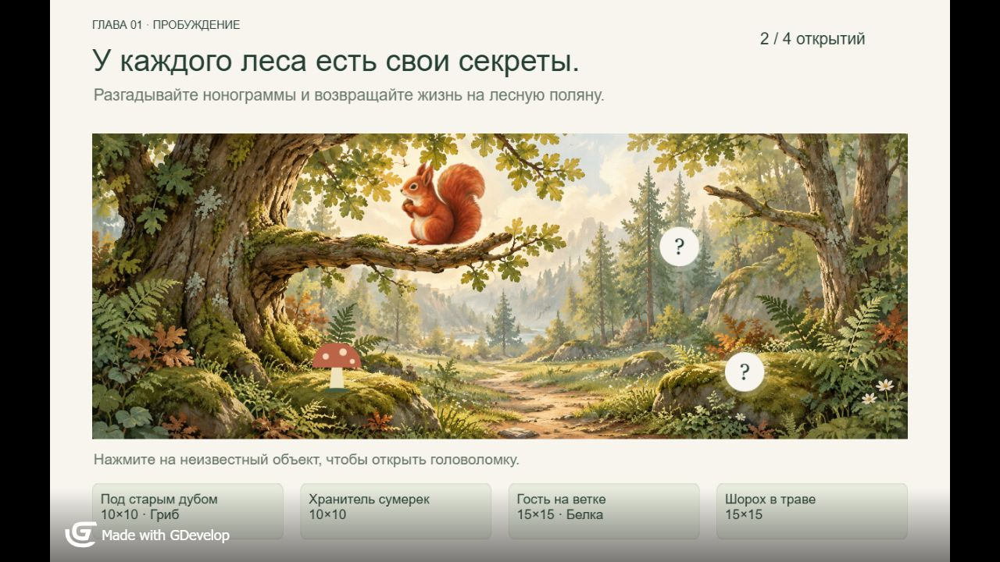

# Тихий лес / Quiet Forest

Игровой прототип нонограмм на **GDevelop + JavaScript**, созданный с помощью AI-инструментов. Четыре головоломки постепенно открывают обитателей лесной поляны.

**[Играть в браузере](https://ZiRiDgpt.github.io/quiet-forest-nonogram/)** · [Исходный проект GDevelop](game.json)



## Что можно посмотреть

- Нонограммы 10×10 и 15×15: гриб, сова, белка и ёж.
- Заполнение клеток, крестики, автокрестики и подсветка решённых групп подсказок.
- Три жизни, обработка ошибок и перезапуск попытки.
- Цикл «поляна → головоломка → награда → открытие на поляне».
- Локальное сохранение прогресса и незавершённой попытки.
- Превращение решённого поля в иллюстрацию.

## Реализация и AI-workflow

Игровые сцены используют нативные Sprite/Text-объекты GDevelop. Правила, состояние попытки, ввод и переходы реализованы JavaScript-модулями и встроены в события проекта.

AI-инструменты применялись при разработке и создании графики. Для белки реализован воспроизводимый путь от сгенерированной иллюстрации через обработку альфа-силуэта к сетке 15×15 с проверкой единственности решения. Промпты и обработка ресурсов описаны в [ART.md](ART.md).

## Запуск и управление

Демо рассчитано прежде всего на настольный браузер и мышь. Нажмите на неизвестный объект в лесу, чтобы выбрать головоломку. ЛКМ заполняет клетку, ПКМ ставит крестик; можно вести по клеткам. Переключение инструментов доступно в интерфейсе. Сохранение привязано к браузеру и адресу сайта.

Для локального запуска готового экспорта:

```sh
python -m http.server 8766 --bind 127.0.0.1 --directory docs
```

Откройте http://127.0.0.1:8766/. Для редактирования откройте `game.json` в GDevelop 5 (проект проверялся на 5.6.284) и запустите сцену `Forest`.

## Исходники и проверки

- `logic/core.js` — подсказки, преобразование изображения и решатель.
- `logic/session.js` — попытка, жизни, отметки и сохранения.
- `logic/runtime.js` — адаптер GDevelop, ввод, анимации и переходы.
- `logic/levels.js`, `data/` — уровни и данные подготовки графики.
- `tests/` — 16 проверок: игровые циклы четырёх уровней, сохранения, ошибки, загрузка встроенных модулей и единственность головоломки белки.
- `docs/` — готовый HTML5-экспорт для GitHub Pages.
- `tools/` — генерация проекта, синхронизация логики и подготовка ресурсов.

```sh
npm test
```

Изменения `logic/*.js` нужно перенести во встроенные события командой `python tools/sync-logic.py`. Генератор `python tools/build-project.py --output game.generated.json` создаёт отдельную версию; запуск без `--output` перезаписывает основной проект. Перед заменой сохраняйте ручные правки. После правок экспортируйте HTML5 из GDevelop; опубликованный `docs/` является готовым снимком сборки.

## Статус и ограничения

Это прототип для портфолио, не релиз и не готовый рекламный playable. Мобильная адаптация, touch-проверка, рекламные SDK и публикация в магазинах не выполнены. Фото-мастерская — скрытая незавершённая сцена. Часть графики временная; рисунки леса и белки созданы с помощью ИИ. Адаптер переходов проверяется автоматическими тестами, что не заменяет тестирование на реальных устройствах.

## Сторонние компоненты

HTML5-экспорт содержит GDevelop runtime и его зависимости. Их авторские уведомления и лицензии сохраняются в файлах. `tools/reference/` содержит справочные исходники GDevelop, а не авторский код проекта. Репозиторий опубликован для просмотра портфолио; отдельная лицензия на свободное использование всего проекта не предоставляется.
